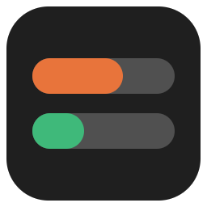
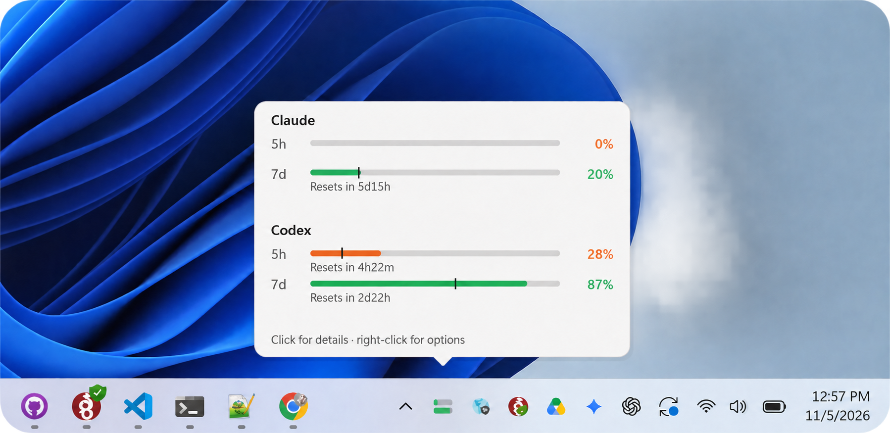

<div align="center">



# BurnBar

**Claude, Codex, OpenCode Go and Cursor usage in your tray.**<br>
See how fast you are using your plans without leaving what you are doing.

[](https://github.com/nooblk-98/burnbar/actions/workflows/build.yml)
[](https://github.com/nooblk-98/burnbar/actions/workflows/rust.yml)
[](https://github.com/nooblk-98/burnbar/releases)
[](rust/README.md)
[](#install)
[](LICENSE)



</div>

BurnBar is a tray app for the AI coding plans you already pay for. It shows the
usage windows each provider reports, warns before a limit, and keeps a week of
readings so you can see your pace. It reads existing local logins; it does not
proxy your traffic or send usage anywhere.

> [!NOTE]
> BurnBar is an unofficial community project, not affiliated with or endorsed by
> Anthropic, OpenAI, OpenCode or Cursor.

## Features

- **Four providers.** Claude, Codex, OpenCode Go and Cursor, with their reported
  session, weekly or monthly windows and reset times. Choose any combination in
  Settings.
- **Compact tray popup.** Click the tray icon for the original small usage card,
  anchored beside the tray and closed automatically after the saved delay.
  Right-click the tray icon for Settings, About and refresh controls.
- **Milestone cards.** A small card appears when a quota crosses 10%, 20%, … 100%.
  Notice only the highest new milestone, not every skipped threshold, and never
  replay old milestones after a restart.
- **Notifications.** Independent session/weekly thresholds, 80% and 95% alerts,
  reset alerts, snooze, quiet hours, and native or in-app notice styles.
- **Pace at a glance.** Each quota keeps the familiar progress bar, reset time and
  pace marker without opening a separate details dashboard.
- **Clear status.** See how old a reading is, when a provider needs sign-in, and
  when a rate limit will retry. Failed refreshes keep the last good numbers
  without pretending they are fresh.
- **Settings that stick.** Refresh interval, popup delay, provider selection,
  theme, text size, start at login, Ctrl+Alt+B and always-show. Stored in the
  same profile format the app has always used.
- **Privacy by default.** Read-only access to local credentials, no telemetry,
  no proxy, and update checks that only read public release metadata.
- **Lightweight.** One Rust/Tauri executable and a system web view. No background
  service, no taskbar widget and no overlay windows.

## Install

### Windows (npx)

You need Windows 10 or 11, Node.js 22+ and a signed-in provider.

```powershell
npx --yes burnbar@latest install
```

The installer downloads the checksum-verified `burnbar.exe` from GitHub Releases
and installs it to `%LOCALAPPDATA%\Programs\BurnBar`. Use
`npx --yes burnbar@latest update` to update. Development builds use
`--channel development`. Neither command enables an automatic updater.

> [!WARNING]
> BurnBar is distributed **unsigned**, so Windows Smart App Control or
> SmartScreen may warn about it. Verify the SHA-256 published with the release if
> you need to.

### macOS and Linux

There is no signed installer yet. Build the app from source below, or use the
CI artifacts attached to a run of the `rust` workflow. The app uses the same
profile files on every platform.

## Providers

| Provider | What BurnBar reads | What it shows |
| --- | --- | --- |
| Claude | Claude Code's stored OAuth token | 5-hour session, weekly, extra model windows, product breakdown |
| Codex | Local `codex app-server` account RPCs | Account-reported session/weekly windows and durations |
| OpenCode Go | OpenCode's read-only credential store | 5-hour rolling, weekly and monthly allowance |
| Cursor | Cursor's read-only local session | Monthly plan usage, auto/API splits, cycle reset |

Credentials never leave your computer except as the provider's own authenticated
usage request. See [PRIVACY.md](PRIVACY.md).

## Build from source

You need [Rust 1.80+](https://rustup.rs/). On Linux also install WebKitGTK and
AppIndicator:

```bash
sudo apt install libwebkit2gtk-4.1-dev libayatana-appindicator3-dev librsvg2-dev
```

```bash
cd rust
cargo run -p burnbar-desktop -- --demo   # sample data, no account needed
cargo run -p burnbar-desktop             # real provider usage
cargo test --workspace                   # unit and mock-HTTP integration tests
cargo build --release -p burnbar-desktop
```

Installers need the Tauri CLI:

```bash
cargo install tauri-cli --version "^2"
cd rust/apps/desktop && cargo tauri build
```

Flags: `--demo` uses sample data and writes nothing, `--hidden` starts in the
tray, and `--providers claude|codex|opencode|cursor|both|all` limits one run
without saving the choice.

## Project layout

```
rust/
├── crates/burnbar-core/   portable providers, config, history, alerts, forecasts
└── apps/desktop/          Tauri tray shell + one HTML/CSS/JS interface
npm/                       npx installer for Windows releases
docs/                      screenshots and release notes
.github/workflows/         Rust CI, Windows release, npm and winget publishing
```

Details: [rust/README.md](rust/README.md) · [release process](docs/RELEASING.md)
· [privacy](PRIVACY.md)

## Contributing

Bug reports, provider integrations and documentation fixes are welcome. See
[CONTRIBUTING.md](CONTRIBUTING.md) for the Rust checks and the project skills
pinned under `.agents/skills`.

## License

[MIT](LICENSE)
