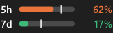
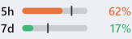

# Claude Usage Meter

A small Windows 11 taskbar widget that shows your Claude plan usage as two bars.




- **5h**: the rolling 5-hour session limit (orange)
- **7d**: the weekly limit across all models (green)
- Bars turn red at 90%. The thin tick on each bar is the **pace marker**: how much of the
  window's time has passed. If the bar is past the tick, you're on track to hit the limit
  before it resets.

> Unofficial community project. Not affiliated with or endorsed by Anthropic.
> "Claude" is a trademark of Anthropic, PBC.

## Install

Requires Windows 10 or 11 and [Claude Code](https://claude.com/claude-code), signed in with a
Claude subscription (the meter uses that login).

- **winget**: `winget install <package-id>` (once the package is published)
- **Manual**: download `claude-usage.exe` from the latest
  [release](../../releases/latest), put it anywhere, and run it. Releases are code-signed, so
  Smart App Control and SmartScreen let them run.

Right-click the meter (or its tray icon) and tick **Start with Windows** to launch it at sign-in.

## Features

- Finds free space on the taskbar (via UI Automation) so it doesn't cover app icons. The
  position can be pinned to the left side or next to the tray icons instead.
- Hover to see time until each limit resets.
- Click for a details panel: every limit the API reports (including per-model weekly limits),
  reset times, pace, 24-hour and 7-day history charts, and this week's usage by product.

  

- Notifications at 80% and 95%, and when a limit you'd been close to resets.
- Refreshes every 1–10 minutes (default 3), within a minute of Claude Code activity, and right
  after a limit resets. Backs off automatically if the API rate-limits.
- Tray icon with tooltip and menu; a meter on every monitor's taskbar; hides for fullscreen
  apps; follows the light/dark taskbar theme and display scaling.

## Privacy

The meter reads the OAuth token Claude Code stores in `%USERPROFILE%\.claude\.credentials.json`
(or `%CLAUDE_CONFIG_DIR%`) and sends it **only** to `https://api.anthropic.com/api/oauth/usage`,
the same endpoint Claude Code's `/usage` command uses. It never modifies or refreshes the
token. If the token expires, run `claude` once.

Settings, alert state and a week of usage history are stored locally in
`%APPDATA%\ClaudeUsageMeter\`. Nothing is sent anywhere else, and there is no telemetry.

The usage endpoint is undocumented and may change or stop working at any time.

## Build from source

Requires Go 1.24+ on Windows.

```powershell
.\build.ps1                 # vet, test, build bin\claude-usage.exe
.\build.ps1 -Resources      # also regenerate the icon, manifest and version info
```

| Flag | Purpose |
|---|---|
| `-demo` | sample numbers and history, no API calls |
| `-once` | print the raw API response and a summary, then exit (needs a console build: `go build -o bin\cu-cli.exe ./cmd/claude-usage`) |
| `-snapshot <dir>` | write widget and popup PNGs (light and dark) to a folder, then exit; combine with `-demo` |

Local builds are unsigned, so Windows **Smart App Control** may block them. Signed builds come
from the release workflow. See [docs/SIGNING.md](docs/SIGNING.md).

## Project layout

```
cmd/claude-usage/     entry point, flags, embedded icon/manifest (rsrc_windows_amd64.syso)
internal/app/         Windows UI: taskbar overlays, tray icon, popup, menu, timers, Win32 + UI Automation
internal/usage/       reading the Claude Code login and parsing the usage API
internal/render/      drawing the widget, popup, charts and tray icon
internal/layout/      choosing a free spot on the taskbar
internal/config/      settings and alert state
internal/history/     usage history for the charts
tools/genres/         generates the icon and Windows resources
assets/               app icon
docs/                 release and signing guide
.github/workflows/    CI, signed releases, winget publishing
```

## Code signing policy

Free code signing provided by [SignPath.io](https://about.signpath.io), certificate by
[SignPath Foundation](https://signpath.org).

- Committers and reviewers: [Lahiru S Liyanage](https://github.com/nooblk-98)
- Approvers: [Lahiru S Liyanage](https://github.com/nooblk-98)

Every release is built by GitHub Actions from this repository's source and signed only after
manual approval. This program connects only to `api.anthropic.com`, to read the signed-in
user's own usage, as described under [Privacy](#privacy).

## License

[MIT](LICENSE)
