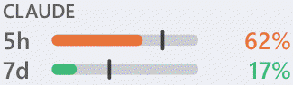
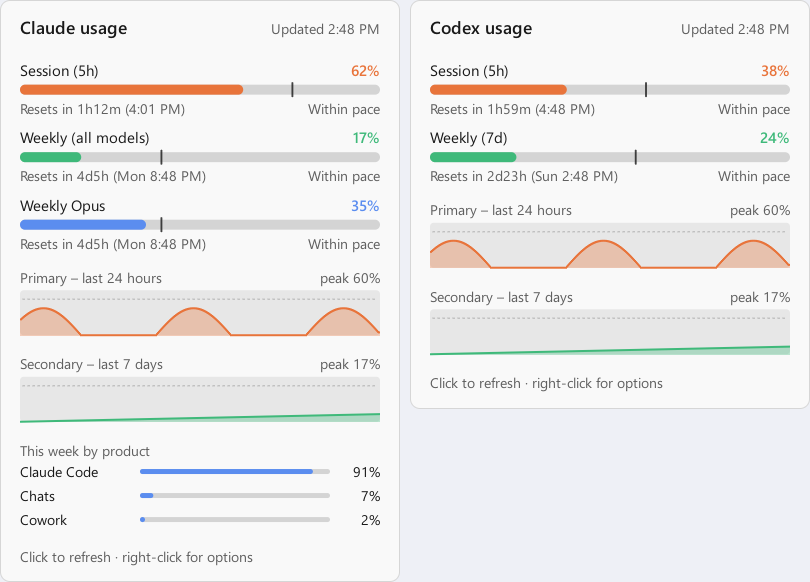

<div align="center">


# BurnBar

[](https://github.com/nooblk-98/burnbar/actions/workflows/build.yml)
[](https://github.com/nooblk-98/burnbar/releases)
[](go.mod)
[](#installation)
[](LICENSE)

**Claude and Codex usage meter for the Windows taskbar.**<br>
See how fast you're burning through your plan limits without leaving what you're doing.

[Features](#features) • [Installation](#installation) • [Usage](#usage) • [How it works](#how-it-works) • [Build from source](#build-from-source)

<picture>
  <source media="(prefers-color-scheme: dark)" srcset="docs/images/meter-rotation-dark.gif">
  
</picture>
<br>
<sub>Sample readings. One compact meter, two providers, a downward flip every 8 seconds.</sub>

</div>

Claude and Codex have session and longer-term plan limits. BurnBar keeps both providers on your
taskbar, warns you before you run out, and shows whether you're using them faster than the time
window allows. Use both together, or select one from **Usage providers** in the right-click menu.
Codex window lengths come from your account rather than assuming every plan uses the same limits.

> [!NOTE]
> BurnBar is an unofficial community project, not affiliated with or endorsed by Anthropic or OpenAI.
> "Claude" and "Codex" belong to their respective owners.

## Features

- **Claude + Codex**: one compact meter rotates between providers every 8 seconds with a downward
  flip animation. The provider name stays visible above its two quota bars. Rotation pauses on
  hover and while details are open, and respects Windows' animation setting.
  Select Claude only or Codex only to keep one provider visible. Bars turn red at 90%.
- **Pace marker**: a tick on each bar shows how much of the window's time has passed. A bar past its
  tick means you'll hit the limit before it resets.
- **Stays out of the way**: finds free space on the taskbar so it never covers app icons, follows the
  light/dark theme and display scaling, and hides during fullscreen apps and games.
  The meter narrows when taskbar buttons need more room. If the taskbar is full, it moves just
  above the bar until space opens. Search, Start and ordinary window clicks keep it visible.
- **Details panel**: separate provider panels, reported quota windows, reset times, and independent
  24-hour and 7-day history charts. Claude also shows this week's usage by product when available.
- **Alerts**: Windows notifications at 80% and 95%, and when a limit you'd been close to resets.
- **Fresh numbers**: refreshes on a schedule, within a minute of Claude Code or Codex activity, and right after
  a limit resets, backing off automatically if the API rate-limits.
- **Multi-monitor**: a meter on every taskbar, plus a tray icon with tooltip and menu.
- **Lightweight**: a single executable with no installer. Codex usage uses your existing Codex CLI.

## Installation

You need Windows 10 or 11 and a signed-in provider:

- **Claude:** [Claude Code](https://claude.com/claude-code) signed in with a Claude subscription.
- **Codex:** [Codex CLI](https://developers.openai.com/codex/cli/) signed in with **ChatGPT**
  (`codex login`). API-key-only accounts do not provide these subscription usage limits.
  BurnBar also detects the CLI bundled with the Windows Codex desktop app when available.

Both providers rotate through the meter by default. A missing login affects only that provider. Select
**Usage providers** from the right-click menu to hide a provider you don't use.

Download `burnbar.exe` from the [releases page](https://github.com/nooblk-98/burnbar/releases),
put it anywhere (for example `%LOCALAPPDATA%\Programs\BurnBar`), and run it.

> [!NOTE]
> BurnBar is distributed **unsigned**. Windows Smart App Control may block it,
> and SmartScreen may show *Windows protected your PC*.

## Usage

Run `burnbar.exe`. The meter appears on the taskbar, and an icon appears in the notification area.
With both providers enabled, the meter switches between **Claude** and **Codex** every 8 seconds.
The provider name above the bars identifies the reading; hover to pause rotation.
The duration beside each bar is reported by the provider (commonly `5h` and `7d`). A dash means
that quota wasn't reported; an exclamation mark means usage is unavailable. Click for details.

| On the meter | Meaning |
|---|---|
| **5h** bar | Share of the rolling 5-hour session limit used |
| **7d** bar | Share of the weekly limit (all models) used |
| Thin tick | How far through the window you are in time (the pace marker) |
| Red bar | 90% or more used |

| Action | Result |
|---|---|
| Hover the meter | Pauses rotation and shows time until each limit resets |
| Click the meter or tray icon | Opens the details panel (click it to refresh, <kbd>Esc</kbd> to close) |
| Right-click the meter or tray icon | Opens the settings menu |

<div align="center">
<picture>
  <source media="(prefers-color-scheme: dark)" srcset="docs/images/popup-dark.png">
  
</picture>
<br>
<sub>Details for both providers, using sample data. <a href="docs/images/popup-dark.png">Dark theme</a> · <a href="docs/images/popup-light.png">Light theme</a></sub>
</div>

From the right-click menu you can:

- **Refresh now** or change the **Refresh interval** (1, 3, 5 or 10 minutes)
- Choose **Usage providers**: *Claude + Codex*, *Claude only*, or *Codex only*
- Choose the **Position**: *Auto* (free space), *Left side* or *Next to tray icons*
- Toggle **Show on taskbar**, **Show on all monitors** and **Usage alerts**
- Turn on **Start with Windows**

> [!TIP]
> Turn on **Start with Windows** once, and BurnBar launches every time you sign in.

## How it works

**Claude:** BurnBar reads the OAuth token that Claude Code saves in `%USERPROFILE%\.claude\.credentials.json`
(or `%CLAUDE_CONFIG_DIR%`) and calls `https://api.anthropic.com/api/oauth/usage`, the same endpoint
Claude Code's `/usage` command uses. To place itself, it reads the taskbar button positions through
Windows UI Automation and picks the free gap closest to the notification area.

**Codex:** BurnBar starts a short-lived local `codex app-server` process and uses the documented
[`account/read` and `account/rateLimits/read`](https://developers.openai.com/codex/app-server/)
requests. It uses Codex's existing login and honors `CODEX_HOME`. It does not start conversations
or model turns. If automatic detection fails, set `BURNBAR_CODEX_PATH` to the full path to the
native `codex.exe` before starting BurnBar. The CLI must support the account app-server methods.

**Privacy.** Claude's token is sent only to `api.anthropic.com`; BurnBar never modifies or refreshes
it. Codex authentication and network requests are handled by the installed Codex CLI using its
configured OpenAI services. BurnBar does not read or copy Codex credentials. BurnBar has no telemetry.
Settings, alert state and separate histories stay on your PC in `%APPDATA%\BurnBar\`;
Claude's existing `history.jsonl` is preserved and Codex uses `history-codex.jsonl`.

> [!IMPORTANT]
> Claude's usage endpoint is undocumented and may change or stop working at any time. If the meter shows
> a login error, run `claude` once so Claude Code refreshes its token.

## Build from source

You need [Go 1.26+](https://go.dev/dl/) on Windows.

```powershell
git clone https://github.com/nooblk-98/burnbar.git
cd burnbar
.\build.ps1
.\bin\burnbar.exe
```

`build.ps1` runs vet and the tests, then builds `bin\burnbar.exe`. Add `-Resources` to regenerate
the icon, manifest and version info, or `-SkipTests` to skip the tests.

The executable also accepts a few flags for development:

| Flag | Description |
|---|---|
| `-demo` | Show sample numbers and history without calling the API |
| `-providers both` | Show Claude and Codex; also accepts `claude` or `codex`. Defaults to the saved menu setting. |
| `-taskbar-layout` | Print measured taskbar spans and the compact meter's available slot, then exit. Useful for diagnosing placement. |
| `-snapshot <dir>` | Render PNG previews and the provider-rotation GIF in both themes, then exit. Combine with `-demo -providers both`. |
| `-once` | Print usage summaries for the selected providers, then exit. Needs a console build: `go build -o bin\burnbar-cli.exe ./cmd/burnbar` |

> [!WARNING]
> Local builds and release builds are unsigned, so Windows **Smart App Control** may block them.
> See [Releasing BurnBar](docs/RELEASING.md) for the release process.

<details>
<summary><strong>Project layout</strong></summary>

```
cmd/burnbar/          entry point, flags, embedded icon and manifest
internal/app/         Windows UI: taskbar meters, tray icon, details panel, menu, Win32 and UI Automation
internal/usage/       Claude usage client and Codex app-server account client
internal/render/      drawing the meter, details panel, charts and tray icon
internal/layout/      choosing a free spot on the taskbar
internal/config/      settings and alert state
internal/history/     usage history for the charts
tools/genres/         icon and Windows resource generator
assets/               app icon
docs/                 screenshots and release guide
.github/workflows/    CI, GitHub releases and optional winget publishing
```

</details>
