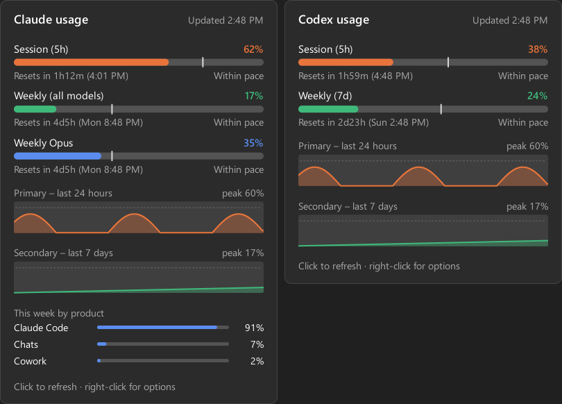

<div align="center">


# BurnBar

[](https://github.com/nooblk-98/burnbar/actions/workflows/build.yml)
[](https://github.com/nooblk-98/burnbar/releases)
[](go.mod)
[](#installation)
[](LICENSE)

**Claude usage meter for the Windows taskbar.**<br>
See how fast you're burning through your Claude plan limits without leaving what you're doing.

[Features](#features) • [Installation](#installation) • [Usage](#usage) • [How it works](#how-it-works) • [Build from source](#build-from-source)


</div>

Claude plans have a rolling **5-hour session limit** and a **weekly limit**. Claude Code shows them
when you run `/usage`, but it's easy to hit one mid-task. BurnBar keeps both on your taskbar as two
small bars, warns you before you run out, and shows whether you're using them faster than the
time window allows.

> [!NOTE]
> BurnBar is an unofficial community project, not affiliated with or endorsed by Anthropic.
> "Claude" is a trademark of Anthropic, PBC.

## Features

- **Two bars, always visible**: session (5h, orange) and weekly (7d, green) usage, turning red at 90%.
- **Pace marker**: a tick on each bar shows how much of the window's time has passed. A bar past its
  tick means you'll hit the limit before it resets.
- **Stays out of the way**: finds free space on the taskbar so it never covers app icons, follows the
  light/dark theme and display scaling, and hides during fullscreen apps and games.
- **Details panel**: every limit your plan reports (including per-model weekly limits), reset times,
  24-hour and 7-day history charts, and this week's usage by product.
- **Alerts**: Windows notifications at 80% and 95%, and when a limit you'd been close to resets.
- **Fresh numbers**: refreshes on a schedule, within a minute of Claude Code activity, and right after
  a limit resets, backing off automatically if the API rate-limits.
- **Multi-monitor**: a meter on every taskbar, plus a tray icon with tooltip and menu.
- **Lightweight**: a single ~7 MB executable with no runtime or installer.

## Installation

You need Windows 10 or 11 and [Claude Code](https://claude.com/claude-code) signed in with a Claude
subscription. BurnBar uses that login, so there's nothing else to configure.

**winget**

```powershell
winget install nooblk-98.BurnBar
```

**Manual**: download `burnbar.exe` from the [latest release](https://github.com/nooblk-98/burnbar/releases/latest),
put it anywhere (for example `%LOCALAPPDATA%\Programs\BurnBar`), and run it.

> [!NOTE]
> Code signing through the SignPath Foundation and the winget package are still in progress, so
> current releases are **unsigned pre-releases**. Windows Smart App Control blocks unsigned apps,
> and SmartScreen shows *Windows protected your PC* (choose **More info → Run anyway**). Signed
> releases will follow once signing is approved.

## Usage

Run `burnbar.exe`. The meter appears on the taskbar, and an icon appears in the notification area.

| On the meter | Meaning |
|---|---|
| **5h** bar | Share of the rolling 5-hour session limit used |
| **7d** bar | Share of the weekly limit (all models) used |
| Thin tick | How far through the window you are in time (the pace marker) |
| Red bar | 90% or more used |

| Action | Result |
|---|---|
| Hover the meter | Shows time until each limit resets |
| Click the meter or tray icon | Opens the details panel (click it to refresh, <kbd>Esc</kbd> to close) |
| Right-click the meter or tray icon | Opens the settings menu |

<div align="center">


</div>

From the right-click menu you can:

- **Refresh now** or change the **Refresh interval** (1, 3, 5 or 10 minutes)
- Choose the **Position**: *Auto* (free space), *Left side* or *Next to tray icons*
- Toggle **Show on taskbar**, **Show on all monitors** and **Usage alerts**
- Turn on **Start with Windows**

> [!TIP]
> Turn on **Start with Windows** once, and BurnBar launches every time you sign in.

## How it works

BurnBar reads the OAuth token that Claude Code saves in `%USERPROFILE%\.claude\.credentials.json`
(or `%CLAUDE_CONFIG_DIR%`) and calls `https://api.anthropic.com/api/oauth/usage`, the same endpoint
Claude Code's `/usage` command uses. To place itself, it reads the taskbar button positions through
Windows UI Automation and picks the free gap closest to the notification area.

**Privacy.** The token is only ever sent to `api.anthropic.com`. BurnBar never modifies or refreshes
it, has no telemetry, and sends nothing anywhere else. Settings, alert state and a week of usage
history stay on your PC in `%APPDATA%\BurnBar\`.

> [!IMPORTANT]
> The usage endpoint is undocumented and may change or stop working at any time. If the meter shows
> a login error, run `claude` once so Claude Code refreshes its token.

## Build from source

You need [Go 1.24+](https://go.dev/dl/) on Windows.

```powershell
git clone https://github.com/nooblk-98/burnbar.git
cd burnbar
.\build.ps1
.\bin\burnbar.exe
```

`build.ps1` runs vet and the tests, then builds `bin\burnbar.exe`. Add `-Resources` to regenerate
the icon, manifest and version info, or `-SkipTests` to skip the tests.

The executable also accepts a few flags for development:

| Flag | Description |
|---|---|
| `-demo` | Show sample numbers and history without calling the API |
| `-snapshot <dir>` | Render the meter and details panel (light and dark) as PNGs, then exit. Combine with `-demo`. |
| `-once` | Print the raw API response and a summary, then exit. Needs a console build: `go build -o bin\burnbar-cli.exe ./cmd/burnbar` |

> [!WARNING]
> Local builds aren't signed, so Windows **Smart App Control** may block them. Signed builds come
> from the [release workflow](.github/workflows/build.yml), described in [docs/SIGNING.md](docs/SIGNING.md).

<details>
<summary><strong>Project layout</strong></summary>

```
cmd/burnbar/          entry point, flags, embedded icon and manifest
internal/app/         Windows UI: taskbar meters, tray icon, details panel, menu, Win32 and UI Automation
internal/usage/       Claude Code login and usage API client
internal/render/      drawing the meter, details panel, charts and tray icon
internal/layout/      choosing a free spot on the taskbar
internal/config/      settings and alert state
internal/history/     usage history for the charts
tools/genres/         icon and Windows resource generator
assets/               app icon
docs/                 screenshots and release guide
.github/workflows/    CI, signed releases and winget publishing
```

</details>

## Code signing policy

Free code signing provided by [SignPath.io](https://about.signpath.io), certificate by
[SignPath Foundation](https://signpath.org).

- Committers and reviewers: [Lahiru S Liyanage](https://github.com/nooblk-98)
- Approvers: [Lahiru S Liyanage](https://github.com/nooblk-98)

Every release is built by GitHub Actions from this repository's source and signed only after manual
approval. The program connects only to `api.anthropic.com`, to read the signed-in user's own usage,
as described under [How it works](#how-it-works).
