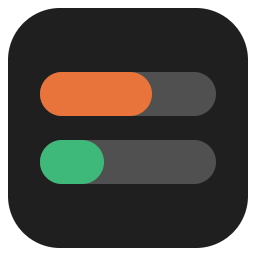
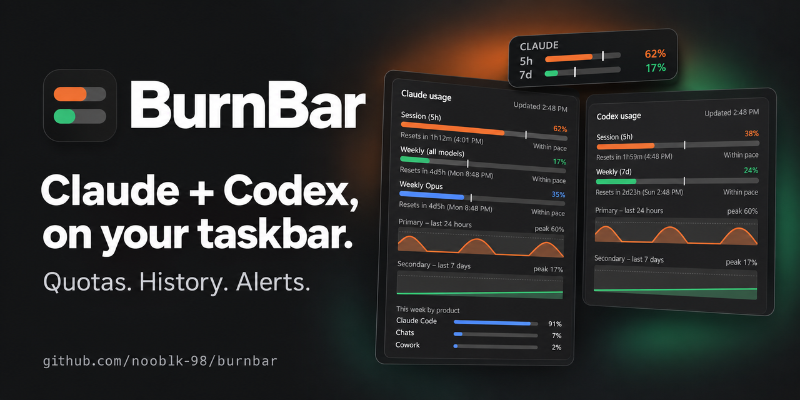
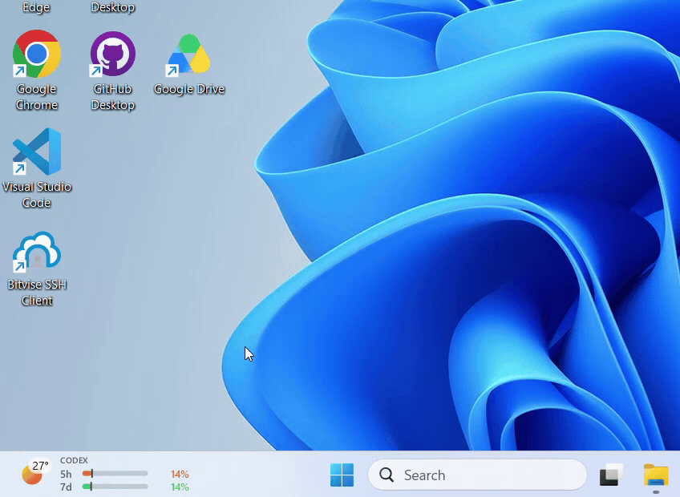

<div align="center">



# BurnBar

[](https://github.com/nooblk-98/burnbar/actions/workflows/build.yml)
[](https://github.com/nooblk-98/burnbar/releases)
[](go.mod)
[](#installation)
[](LICENSE)

**Claude and Codex usage meter for the Windows taskbar.**<br>
See how fast you're burning through your plan limits without leaving what you're doing.

[Features](#features) • [See it in action](#see-it-in-action) • [Installation](#installation) • [Build from source](#build-from-source)



</div>

Claude and Codex have session and longer-term plan limits. BurnBar keeps both providers on your
taskbar, warns you before you run out, and shows whether you're using them faster than the time
window allows. Use both together, or select one from **Usage providers** in the right-click menu.
Codex window lengths come from your account rather than assuming every plan uses the same limits.

> [!NOTE]
> BurnBar is an unofficial community project, not affiliated with or endorsed by Anthropic or OpenAI.
> "Claude" and "Codex" belong to their respective owners.

## Features

- **Claude + Codex**: one compact meter rotates between providers every 8 seconds with a downward
  flip animation. The provider name stays visible above its two quota bars. Rotation pauses on
  hover and while details are open, and respects Windows' animation setting.
  Select Claude only or Codex only to keep one provider visible. Bars turn red at 90%.
- **Pace marker**: a tick on each bar shows how much of the window's time has passed. A bar past its
  tick means you'll hit the limit before it resets.
- **Stays out of the way**: finds free space on the taskbar so it never covers app icons, follows the
  light/dark theme and display scaling, and hides during fullscreen apps and games.
  The meter narrows when taskbar buttons need more room. If the taskbar is full, it moves just
  above the bar until space opens. Search, Start and ordinary window clicks keep it visible.
- **Details panel**: separate provider panels, reported quota windows, reset times, and independent
  24-hour and 7-day history charts. Claude also shows this week's usage by product when available.
- **Alerts**: Windows notifications at 80% and 95%, and when a limit you'd been close to resets.
- **Fresh numbers**: refreshes on a schedule, within a minute of Claude Code or Codex activity, and right after
  a limit resets, backing off automatically if the API rate-limits.
- **Multi-monitor**: a meter on every taskbar, plus a tray icon with tooltip and menu.
- **Lightweight**: a single executable with no installer. Codex usage uses your existing Codex CLI.
- **Start with Windows**: enabled on first launch for new users; turn it off from the
  right-click menu at any time. Existing startup preferences are preserved.
- **About**: right-click the meter or tray icon for the app version, developer credits,
  and a link to this repository.

## See it in action

<div align="center">

<br>
<sub>BurnBar in action: Claude and Codex usage on the taskbar, with details a click away.</sub>
</div>

## Installation

You need Windows 10 or 11 and a signed-in provider:

- **Claude:** [Claude Code](https://claude.com/claude-code) signed in with a Claude subscription.
- **Codex:** [Codex CLI](https://developers.openai.com/codex/cli/) signed in with **ChatGPT**
  (`codex login`). API-key-only accounts do not provide these subscription usage limits.
  BurnBar also detects the CLI bundled with the Windows Codex desktop app when available.

Both providers rotate through the meter by default. A missing login affects only that provider. Select
**Usage providers** from the right-click menu to hide a provider you don't use.

Download `burnbar.exe` from the [releases page](https://github.com/nooblk-98/burnbar/releases),
put it anywhere (for example `%LOCALAPPDATA%\Programs\BurnBar`), and run it.

On its first normal launch, BurnBar enables **Start with Windows** for a new profile.
You can disable it from the right-click menu. Demo and diagnostic modes do not enable it.

> [!NOTE]
> BurnBar is distributed **unsigned**. Windows Smart App Control may block it,
> and SmartScreen may show *Windows protected your PC*.

### If Smart App Control blocks BurnBar (Windows 11)

> [!WARNING]
> Turning off Smart App Control reduces protection for your whole PC. Recent Windows
> updates support turning it back on, but availability depends on your device and
> configuration. If Windows warns that restoring it requires a reset or reinstall,
> do not proceed expecting a temporary change.

1. Install the latest Windows updates before changing this setting.
2. Open **Windows Security > App & browser control > Smart App Control settings**.
3. If you trust the download and choose to proceed, select **Off** before running
   BurnBar. Read the confirmation carefully.
4. Download `burnbar.exe` from this repository's releases, place it in your preferred
   folder, and run it. BurnBar is portable and has no installer.
5. Afterwards, return to **Smart App Control settings** and select **On**, if
   available. Restart if Windows asks, and confirm protection is on.

Turning protection back on may block BurnBar again. Running it once does not create
an exception for the app. See [Microsoft's Smart App Control FAQ](https://support.microsoft.com/en-us/windows/security/threat-malware-protection/smart-app-control-frequently-asked-questions)
for current requirements and limitations.

## Build from source

You need [Go 1.26+](https://go.dev/dl/) on Windows.

```powershell
git clone https://github.com/nooblk-98/burnbar.git
cd burnbar
.\build.ps1
.\bin\burnbar.exe
```

`build.ps1` runs vet and the tests, then builds `bin\burnbar.exe`. Add `-Resources` to regenerate
the icon, manifest and version info, or `-SkipTests` to skip the tests.

The executable also accepts a few flags for development:

| Flag | Description |
|---|---|
| `-demo` | Show sample numbers and history without calling the API |
| `-providers both` | Show Claude and Codex; also accepts `claude` or `codex`. Defaults to the saved menu setting. |
| `-taskbar-layout` | Print measured taskbar spans and the compact meter's available slot, then exit. Useful for diagnosing placement. |
| `-snapshot <dir>` | Render PNG previews and the provider-rotation GIF in both themes, then exit. Combine with `-demo -providers both`. |
| `-once` | Print usage summaries for the selected providers, then exit. Needs a console build: `go build -o bin\burnbar-cli.exe ./cmd/burnbar` |

> [!WARNING]
> Local builds and release builds are unsigned, so Windows **Smart App Control** may block them.
> See [Releasing BurnBar](docs/RELEASING.md) for the release process.

<details>
<summary><strong>Project layout</strong></summary>

```
cmd/burnbar/          entry point, flags, embedded icon and manifest
internal/app/         Windows UI: taskbar meters, tray icon, details panel, menu, Win32 and UI Automation
internal/usage/       Claude usage client and Codex app-server account client
internal/render/      drawing the meter, details panel, charts and tray icon
internal/layout/      choosing a free spot on the taskbar
internal/config/      settings and alert state
internal/history/     usage history for the charts
tools/genres/         icon and Windows resource generator
assets/               app icon
docs/                 screenshots and release guide
.github/workflows/    CI, GitHub releases and optional winget publishing
```

</details>

## Contributing

Contributors are welcome! Bug fixes, documentation improvements, and new AI tool
integrations are all appreciated. Feel free to open a pull request.

See the [contribution guide](CONTRIBUTING.md) for setup and checks, the
[roadmap](ROADMAP.md) for upcoming work, and [privacy details](PRIVACY.md) for data
access and storage.

Support for more AI tools is coming soon. To request a specific tool or suggest a
feature, [open an issue](https://github.com/nooblk-98/burnbar/issues/new/choose) and tell us
what you would like to see.
